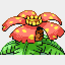
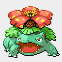
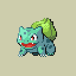

# LeafGreen public graphics

This page is generated from the repository's verified `graphics/` tree. Japanese and Korean assets are listed before English and other official languages.

## Header

| Preview | File | Language | Size | SHA-256 |
| --- | --- | --- | --- | --- |
|  | [`graphics/header/nintendo-logo.png`](graphics/header/nintendo-logo.png) | Unspecified | 416x64 | `f07daf6e489d64b7...` |

## Pokemon

| Preview | File | Language | Size | SHA-256 |
| --- | --- | --- | --- | --- |
|  | [`graphics/pokemon/bulbasaur-back-bpg-j-rev0-retail.png`](graphics/pokemon/bulbasaur-back-bpg-j-rev0-retail.png) | Japanese | 128x128 | `447c4eb1a5771b84...` |
|  | [`graphics/pokemon/bulbasaur-front-bpg-j-rev0-retail.png`](graphics/pokemon/bulbasaur-front-bpg-j-rev0-retail.png) | Japanese | 128x128 | `d65f4b47f56189d0...` |
|  | [`graphics/pokemon/pikachu-back-bpg-j-rev0-retail.png`](graphics/pokemon/pikachu-back-bpg-j-rev0-retail.png) | Japanese | 128x128 | `d1472dd2f4862fe9...` |
|  | [`graphics/pokemon/pikachu-front-bpg-j-rev0-retail.png`](graphics/pokemon/pikachu-front-bpg-j-rev0-retail.png) | Japanese | 128x128 | `0be25ad9c369dfb5...` |
|  | [`graphics/pokemon/venusaur-back-bpg-j-rev0-retail.png`](graphics/pokemon/venusaur-back-bpg-j-rev0-retail.png) | Japanese | 128x128 | `aa858c755cfb3ca3...` |
|  | [`graphics/pokemon/venusaur-front-bpg-j-rev0-retail.png`](graphics/pokemon/venusaur-front-bpg-j-rev0-retail.png) | Japanese | 128x128 | `1b5b6d32061cba12...` |
|  | [`graphics/pokemon/bulbasaur-back-bpg-e-rev0-retail.png`](graphics/pokemon/bulbasaur-back-bpg-e-rev0-retail.png) | English | 128x128 | `447c4eb1a5771b84...` |
|  | [`graphics/pokemon/bulbasaur-back-bpg-e-rev1-retail.png`](graphics/pokemon/bulbasaur-back-bpg-e-rev1-retail.png) | English | 128x128 | `447c4eb1a5771b84...` |
|  | [`graphics/pokemon/bulbasaur-front-bpg-e-rev0-retail.png`](graphics/pokemon/bulbasaur-front-bpg-e-rev0-retail.png) | English | 128x128 | `d65f4b47f56189d0...` |
|  | [`graphics/pokemon/bulbasaur-front-bpg-e-rev1-retail.png`](graphics/pokemon/bulbasaur-front-bpg-e-rev1-retail.png) | English | 128x128 | `d65f4b47f56189d0...` |
|  | [`graphics/pokemon/pikachu-back-bpg-e-rev0-retail.png`](graphics/pokemon/pikachu-back-bpg-e-rev0-retail.png) | English | 128x128 | `d1472dd2f4862fe9...` |
|  | [`graphics/pokemon/pikachu-back-bpg-e-rev1-retail.png`](graphics/pokemon/pikachu-back-bpg-e-rev1-retail.png) | English | 128x128 | `d1472dd2f4862fe9...` |
|  | [`graphics/pokemon/pikachu-front-bpg-e-rev0-retail.png`](graphics/pokemon/pikachu-front-bpg-e-rev0-retail.png) | English | 128x128 | `0be25ad9c369dfb5...` |
|  | [`graphics/pokemon/pikachu-front-bpg-e-rev1-retail.png`](graphics/pokemon/pikachu-front-bpg-e-rev1-retail.png) | English | 128x128 | `0be25ad9c369dfb5...` |
|  | [`graphics/pokemon/venusaur-back-bpg-e-rev0-retail.png`](graphics/pokemon/venusaur-back-bpg-e-rev0-retail.png) | English | 128x128 | `aa858c755cfb3ca3...` |
|  | [`graphics/pokemon/venusaur-back-bpg-e-rev1-retail.png`](graphics/pokemon/venusaur-back-bpg-e-rev1-retail.png) | English | 128x128 | `aa858c755cfb3ca3...` |
|  | [`graphics/pokemon/venusaur-front-bpg-e-rev0-retail.png`](graphics/pokemon/venusaur-front-bpg-e-rev0-retail.png) | English | 128x128 | `1b5b6d32061cba12...` |
|  | [`graphics/pokemon/venusaur-front-bpg-e-rev1-retail.png`](graphics/pokemon/venusaur-front-bpg-e-rev1-retail.png) | English | 128x128 | `1b5b6d32061cba12...` |
|  | [`graphics/pokemon/bulbasaur-back-bpg-d-rev0-retail.png`](graphics/pokemon/bulbasaur-back-bpg-d-rev0-retail.png) | German | 128x128 | `447c4eb1a5771b84...` |
|  | [`graphics/pokemon/bulbasaur-front-bpg-d-rev0-retail.png`](graphics/pokemon/bulbasaur-front-bpg-d-rev0-retail.png) | German | 128x128 | `d65f4b47f56189d0...` |
|  | [`graphics/pokemon/pikachu-back-bpg-d-rev0-retail.png`](graphics/pokemon/pikachu-back-bpg-d-rev0-retail.png) | German | 128x128 | `d1472dd2f4862fe9...` |
|  | [`graphics/pokemon/pikachu-front-bpg-d-rev0-retail.png`](graphics/pokemon/pikachu-front-bpg-d-rev0-retail.png) | German | 128x128 | `0be25ad9c369dfb5...` |
|  | [`graphics/pokemon/venusaur-back-bpg-d-rev0-retail.png`](graphics/pokemon/venusaur-back-bpg-d-rev0-retail.png) | German | 128x128 | `aa858c755cfb3ca3...` |
|  | [`graphics/pokemon/venusaur-front-bpg-d-rev0-retail.png`](graphics/pokemon/venusaur-front-bpg-d-rev0-retail.png) | German | 128x128 | `1b5b6d32061cba12...` |
|  | [`graphics/pokemon/bulbasaur-back-bpg-f-rev0-retail.png`](graphics/pokemon/bulbasaur-back-bpg-f-rev0-retail.png) | French | 128x128 | `447c4eb1a5771b84...` |
|  | [`graphics/pokemon/bulbasaur-front-bpg-f-rev0-retail.png`](graphics/pokemon/bulbasaur-front-bpg-f-rev0-retail.png) | French | 128x128 | `d65f4b47f56189d0...` |
|  | [`graphics/pokemon/pikachu-back-bpg-f-rev0-retail.png`](graphics/pokemon/pikachu-back-bpg-f-rev0-retail.png) | French | 128x128 | `d1472dd2f4862fe9...` |
|  | [`graphics/pokemon/pikachu-front-bpg-f-rev0-retail.png`](graphics/pokemon/pikachu-front-bpg-f-rev0-retail.png) | French | 128x128 | `0be25ad9c369dfb5...` |
|  | [`graphics/pokemon/venusaur-back-bpg-f-rev0-retail.png`](graphics/pokemon/venusaur-back-bpg-f-rev0-retail.png) | French | 128x128 | `aa858c755cfb3ca3...` |
|  | [`graphics/pokemon/venusaur-front-bpg-f-rev0-retail.png`](graphics/pokemon/venusaur-front-bpg-f-rev0-retail.png) | French | 128x128 | `1b5b6d32061cba12...` |
|  | [`graphics/pokemon/bulbasaur-back-bpg-i-rev0-retail.png`](graphics/pokemon/bulbasaur-back-bpg-i-rev0-retail.png) | Italian | 128x128 | `447c4eb1a5771b84...` |
|  | [`graphics/pokemon/bulbasaur-front-bpg-i-rev0-retail.png`](graphics/pokemon/bulbasaur-front-bpg-i-rev0-retail.png) | Italian | 128x128 | `d65f4b47f56189d0...` |
|  | [`graphics/pokemon/pikachu-back-bpg-i-rev0-retail.png`](graphics/pokemon/pikachu-back-bpg-i-rev0-retail.png) | Italian | 128x128 | `d1472dd2f4862fe9...` |
|  | [`graphics/pokemon/pikachu-front-bpg-i-rev0-retail.png`](graphics/pokemon/pikachu-front-bpg-i-rev0-retail.png) | Italian | 128x128 | `0be25ad9c369dfb5...` |
|  | [`graphics/pokemon/venusaur-back-bpg-i-rev0-retail.png`](graphics/pokemon/venusaur-back-bpg-i-rev0-retail.png) | Italian | 128x128 | `aa858c755cfb3ca3...` |
|  | [`graphics/pokemon/venusaur-front-bpg-i-rev0-retail.png`](graphics/pokemon/venusaur-front-bpg-i-rev0-retail.png) | Italian | 128x128 | `1b5b6d32061cba12...` |
|  | [`graphics/pokemon/bulbasaur-back-bpg-s-rev0-retail.png`](graphics/pokemon/bulbasaur-back-bpg-s-rev0-retail.png) | Spanish | 128x128 | `447c4eb1a5771b84...` |
|  | [`graphics/pokemon/bulbasaur-front-bpg-s-rev0-retail.png`](graphics/pokemon/bulbasaur-front-bpg-s-rev0-retail.png) | Spanish | 128x128 | `d65f4b47f56189d0...` |
|  | [`graphics/pokemon/pikachu-back-bpg-s-rev0-retail.png`](graphics/pokemon/pikachu-back-bpg-s-rev0-retail.png) | Spanish | 128x128 | `d1472dd2f4862fe9...` |
|  | [`graphics/pokemon/pikachu-front-bpg-s-rev0-retail.png`](graphics/pokemon/pikachu-front-bpg-s-rev0-retail.png) | Spanish | 128x128 | `0be25ad9c369dfb5...` |
|  | [`graphics/pokemon/venusaur-back-bpg-s-rev0-retail.png`](graphics/pokemon/venusaur-back-bpg-s-rev0-retail.png) | Spanish | 128x128 | `aa858c755cfb3ca3...` |
|  | [`graphics/pokemon/venusaur-front-bpg-s-rev0-retail.png`](graphics/pokemon/venusaur-front-bpg-s-rev0-retail.png) | Spanish | 128x128 | `1b5b6d32061cba12...` |

| Palette | Language | Colors | SHA-256 |
| --- | --- | --- | --- |
| [`graphics/pokemon/bulbasaur-bpg-j-rev0-retail.pal`](graphics/pokemon/bulbasaur-bpg-j-rev0-retail.pal) | Japanese | 16 | `77bb91fcdfd9f814...` |
| [`graphics/pokemon/pikachu-bpg-j-rev0-retail.pal`](graphics/pokemon/pikachu-bpg-j-rev0-retail.pal) | Japanese | 16 | `066a8707fdfbf027...` |
| [`graphics/pokemon/venusaur-bpg-j-rev0-retail.pal`](graphics/pokemon/venusaur-bpg-j-rev0-retail.pal) | Japanese | 16 | `3f69efcb38c0bab5...` |
| [`graphics/pokemon/bulbasaur-bpg-e-rev0-retail.pal`](graphics/pokemon/bulbasaur-bpg-e-rev0-retail.pal) | English | 16 | `77bb91fcdfd9f814...` |
| [`graphics/pokemon/bulbasaur-bpg-e-rev1-retail.pal`](graphics/pokemon/bulbasaur-bpg-e-rev1-retail.pal) | English | 16 | `77bb91fcdfd9f814...` |
| [`graphics/pokemon/pikachu-bpg-e-rev0-retail.pal`](graphics/pokemon/pikachu-bpg-e-rev0-retail.pal) | English | 16 | `066a8707fdfbf027...` |
| [`graphics/pokemon/pikachu-bpg-e-rev1-retail.pal`](graphics/pokemon/pikachu-bpg-e-rev1-retail.pal) | English | 16 | `066a8707fdfbf027...` |
| [`graphics/pokemon/venusaur-bpg-e-rev0-retail.pal`](graphics/pokemon/venusaur-bpg-e-rev0-retail.pal) | English | 16 | `3f69efcb38c0bab5...` |
| [`graphics/pokemon/venusaur-bpg-e-rev1-retail.pal`](graphics/pokemon/venusaur-bpg-e-rev1-retail.pal) | English | 16 | `3f69efcb38c0bab5...` |
| [`graphics/pokemon/bulbasaur-bpg-d-rev0-retail.pal`](graphics/pokemon/bulbasaur-bpg-d-rev0-retail.pal) | German | 16 | `77bb91fcdfd9f814...` |
| [`graphics/pokemon/pikachu-bpg-d-rev0-retail.pal`](graphics/pokemon/pikachu-bpg-d-rev0-retail.pal) | German | 16 | `066a8707fdfbf027...` |
| [`graphics/pokemon/venusaur-bpg-d-rev0-retail.pal`](graphics/pokemon/venusaur-bpg-d-rev0-retail.pal) | German | 16 | `3f69efcb38c0bab5...` |
| [`graphics/pokemon/bulbasaur-bpg-f-rev0-retail.pal`](graphics/pokemon/bulbasaur-bpg-f-rev0-retail.pal) | French | 16 | `77bb91fcdfd9f814...` |
| [`graphics/pokemon/pikachu-bpg-f-rev0-retail.pal`](graphics/pokemon/pikachu-bpg-f-rev0-retail.pal) | French | 16 | `066a8707fdfbf027...` |
| [`graphics/pokemon/venusaur-bpg-f-rev0-retail.pal`](graphics/pokemon/venusaur-bpg-f-rev0-retail.pal) | French | 16 | `3f69efcb38c0bab5...` |
| [`graphics/pokemon/bulbasaur-bpg-i-rev0-retail.pal`](graphics/pokemon/bulbasaur-bpg-i-rev0-retail.pal) | Italian | 16 | `77bb91fcdfd9f814...` |
| [`graphics/pokemon/pikachu-bpg-i-rev0-retail.pal`](graphics/pokemon/pikachu-bpg-i-rev0-retail.pal) | Italian | 16 | `066a8707fdfbf027...` |
| [`graphics/pokemon/venusaur-bpg-i-rev0-retail.pal`](graphics/pokemon/venusaur-bpg-i-rev0-retail.pal) | Italian | 16 | `3f69efcb38c0bab5...` |
| [`graphics/pokemon/bulbasaur-bpg-s-rev0-retail.pal`](graphics/pokemon/bulbasaur-bpg-s-rev0-retail.pal) | Spanish | 16 | `77bb91fcdfd9f814...` |
| [`graphics/pokemon/pikachu-bpg-s-rev0-retail.pal`](graphics/pokemon/pikachu-bpg-s-rev0-retail.pal) | Spanish | 16 | `066a8707fdfbf027...` |
| [`graphics/pokemon/venusaur-bpg-s-rev0-retail.pal`](graphics/pokemon/venusaur-bpg-s-rev0-retail.pal) | Spanish | 16 | `3f69efcb38c0bab5...` |

Every entry is tied to at least one existing analysis or manifest record. Full hashes and provenance links are in `analysis/public-graphics-catalog.json`.
